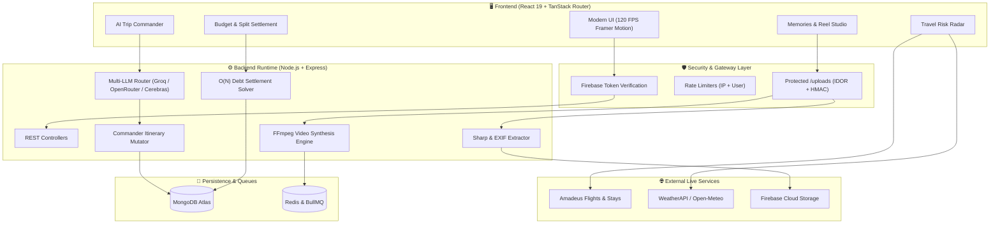

<!-- ================================================================= -->
<!--                    ✨ ADVENZA HERO HEADER ✨                     -->
<!-- ================================================================= -->
<div align="center">

  <br />

  <h1>✈️ A D V E N Z A</h1>

  <p align="center">
    <a href="https://github.com/134shubhamyadav/Advenza">
      
    </a>
  </p>

  <p align="center">
    <strong>An autonomous AI travel platform that designs adaptive itineraries, calculates real budgets, continuously assesses risks, and crafts lasting memories.</strong>
  </p>

  <p align="center">
    <a href="https://react.dev/"></a>
    <a href="https://tanstack.com/router"></a>
    <a href="https://tailwindcss.com/"></a>
    <a href="https://nodejs.org/"></a>
    <a href="https://expressjs.com/"></a>
    <a href="https://www.mongodb.com/"></a>
    <a href="https://redis.io/"></a>
    <a href="https://firebase.google.com/"></a>
  </p>

  <br />

  

  <br /><br />

  <p align="center">
    <a href="#-core-pillars">Core Pillars</a> •
    <a href="#-interactive-architecture--flow">Architecture Flow</a> •
    <a href="#-visual-showcase">Visual Showcase</a> •
    <a href="#-quickstart--installation">Quickstart</a> •
    <a href="#-environment-configuration">Configuration</a> •
    <a href="#-testing--verification">Testing</a> •
    <a href="#-team-workflow">Team Workflow</a>
  </p>

</div>

---

## 🧭 System Status Matrix

```
╭──────────────────────────────────────────────────────────────────────────╮
│  🚀 Production Status : HARDENED & OPERATIONAL                           │
│  🛡️  Media Security    : HMAC Tokens + IDOR Auth + Path Traversal Safe    │
│  ⚡ Payload Pipeline   : Zero Base64 Bottlenecks (Direct Binary Streams) │
│  🛰️  Travel Providers  : Transparent Status Flags (Zero Silent Mocks)    │
│  🎬 Video Synthesis   : Fluent-FFmpeg 1080x1920 @ 30 FPS Rendered In-App │
╰──────────────────────────────────────────────────────────────────────────╯
```

---

## 🌟 Core Pillars

### ⚡ 1. AI Trip Commander & What-If Decision Engine
* **Energy-Aware Pacing**: Generates comprehensive multi-day itineraries that balance intense exploration with commuting buffers and decompression periods.
* **Live What-If Simulation**: Swap a temple for a trek or shift departure dates; the simulation re-evaluates transit time, sun exposure, and budget impact in real-time.
* **Deterministic Event Acceptance**: Commander suggestions (e.g. weather adjustments, delay contingency buffers) can be accepted with one click, cleanly mutating itinerary state in MongoDB without duplicate event processing.
* **Zero Hallucination Tolerance**: Places and events are verified against real spatial anchors.

### 🛰️ 2. Autonomous Travel Radar & Risk Engine
* **Live Flight & Hotel Streaming**: Amadeus API integration for flight schedules, cabin classes, and hotel room availability.
* **Multimodal Spatial Transit**: Distance, estimated driving/transit time, and route mapping via OpenRouteService / OSRM.
* **Proactive Risk Radar**: 24/7 continuous monitoring for sudden weather shifts, convective storm risks, transit strikes, and local crowd surges.
* **Honest Configuration State**: Unconfigured external credentials clearly announce `NOT_CONFIGURED` via structured indicators rather than inventing mock flight numbers.

### 💰 3. Smart Budget, Split Settlements & Price Watch
* **Live Foreign Exchange Engine**: Spend tracking across international currencies with dynamic conversion to home currency.
* **$O(N)$ Debt Minimization Settlement**: Solves group debt transfers using graph theory to settle multi-member trip expenses with the absolute minimum number of peer-to-peer payments.
* **Binary Receipt Scanner**: Instant receipt upload with streaming binary fallback and OCR text extraction for automated itemization.
* **Autonomous Price Watch**: Periodic background polling on flight routes and hotel stays, alerting travelers the moment ticket fares drop.

### 📸 4. Rich Memories, Canvas Collages & FFmpeg Reel Studio
* **Chronological Memory Timeline**: Visual travelogue enriched with EXIF camera metadata, timestamps, and GPS geo-tags.
* **Canvas & Sharp Collage Creator**: Multi-layout templates (Polaroid, Editorial, Storyboard, Grid) rendered client-side on Canvas and backed by server-side Sharp synthesis with 32-character secure share tokens.
* **Automated Reel Video Engine**: Compiles travel photos and videos into full HD 1080x1920 (9:16 vertical) reels at 30 FPS with music audio beds and transition pacing using fluent-ffmpeg.
* **Dual-Layer Cloud & Fallback Storage**: 7-day signed Google Cloud Storage URLs with an immediate, resilient streaming binary fallback to protected local disk storage.

---

## 🔄 Interactive Architecture & Flow



---

## 🎨 Visual Showcase

<div align="center">
  <table>
    <tr>
      <td width="33%" align="center">
        
        <br />
        <b>Energy-Aware Pacing</b>
        <p><i>Adaptive daily schedules with built-in rest & buffer windows.</i></p>
      </td>
      <td width="33%" align="center">
        
        <br />
        <b>Curated Explorations</b>
        <p><i>Handpicked points of interest with verified crowd levels.</i></p>
      </td>
      <td width="33%" align="center">
        
        <br />
        <b>What-If Decision Engine</b>
        <p><i>Real-time route shifts & live contingency re-planning.</i></p>
      </td>
    </tr>
  </table>
</div>

---

## 🚀 Quickstart & Installation

### Prerequisites
- **Node.js**: `v20.0.0` or higher
- **npm**: `v10.0.0` or higher
- **MongoDB**: Running locally at `mongodb://localhost:27017` or a MongoDB Atlas URI
- *(Optional)* **Redis**: Running on `127.0.0.1:6379` for BullMQ reel queue (in-process fallback available in dev)

### 1. Clone & Install
```bash
# Clone the repository
git clone https://github.com/134shubhamyadav/Advenza.git
cd Advenza

# Install all workspace dependencies
npm install
cd backend && npm install
cd ../frontend && npm install
cd ..
```

### 2. Configure Environment
```bash
# Backend setup
cp backend/.env.example backend/.env

# Frontend setup
cp frontend/.env.example frontend/.env
```

### 3. Launch Development Servers
Run both backend (`:5000`) and frontend (`:3000`) concurrently with a single command:
```bash
npm run dev
```

* **Client**: [http://localhost:3000](http://localhost:3000)
* **API**: [http://localhost:5000](http://localhost:5000)
* **Detailed Health Probe**: [http://localhost:5000/health/detailed](http://localhost:5000/health/detailed)

---

## ⚙️ Environment Configuration

<details>
<summary><b>Click to expand Backend Environment Reference (<code>backend/.env</code>)</b></summary>

<br />

| Key | Default | Description |
| :--- | :--- | :--- |
| `PORT` | `5000` | Port for the Express backend API. |
| `NODE_ENV` | `development` | Runtime environment (`development`, `production`, `test`). |
| `CLIENT_URL` | `http://localhost:3000` | Allowed origin for CORS whitelist. |
| `MONGODB_URI` | `mongodb://localhost:27017/Advenza` | Primary MongoDB database connection string. |
| `JWT_SECRET` | *Auto-generated* | HMAC secret used for media file access tokens. |
| `GROQ_API_KEY` | — | High-speed LLM engine (Llama 3.3 70B). |
| `OPENROUTER_API_KEY` | — | Fallback LLM engine. |
| `AMADEUS_CLIENT_ID` | — | Amadeus API key for real flight and hotel queries. |
| `AMADEUS_CLIENT_SECRET`| — | Amadeus API secret. |
| `WEATHER_API_KEY` | — | WeatherAPI key (defaults to Open-Meteo free tier if omitted). |
| `REDIS_URL` | `redis://127.0.0.1:6379` | Redis connection URL for BullMQ. |
| `FIREBASE_STORAGE_BUCKET`| — | Google Cloud Storage bucket for media storage. |
| `FIREBASE_SERVICE_ACCOUNT_JSON`| — | Single-line JSON credential for Firebase Admin SDK. |

</details>

<details>
<summary><b>Click to expand Frontend Environment Reference (<code>frontend/.env</code>)</b></summary>

<br />

| Key | Default | Description |
| :--- | :--- | :--- |
| `VITE_BACKEND_URL` | *(empty)* | Backend base URL. Leave empty in local dev to leverage Vite proxy. |
| `VITE_GOOGLE_MAPS_API_KEY` | — | Google Maps JavaScript API key for location auto-complete. |
| `VITE_WEATHER_API_KEY` | — | Optional frontend direct weather queries. |

</details>

---

## 🔍 Health Checks & Observability

Advenza ships with production-grade health probes:

```bash
# 1. Basic Liveness Check (HTTP 200 OK)
curl http://localhost:5000/health

# 2. Readiness Probe (MongoDB & Queue status)
curl http://localhost:5000/health/ready

# 3. Comprehensive Diagnostic Report (Providers, memory, uptime)
curl http://localhost:5000/health/detailed
```

---

## 🧪 Testing & Verification

Run the verification suites to test the hardened subsystems:

```bash
# Run the 37-point production hardening verification test
node backend/scratch/verify_production_hardening.js

# Test Memories, Collages, and Signed URL systems
node backend/scratch/test_memories_system.js
node backend/scratch/test_collage_system.js

# Test Budget calculations and O(N) debt settlement
node backend/scratch/test_budget_system.js

# Test FFmpeg video rendering pipeline
node backend/scratch/test_reels_system.js
```

---

## 👥 Team Workflow

We use a **Feature Branch Workflow** for continuous collaboration:

```bash
# 1. Pull the latest main
git checkout main
git pull origin main

# 2. Switch to your feature/personal branch
git checkout -B your-branch-name

# 3. Work, test, and commit your changes
git add .
git commit -m "feat(module): description of changes"

# 4. Push to GitHub and submit a Pull Request
git push -u origin your-branch-name
```

---

<div align="center">

  <sub>Crafted with passion in Mumbai</sub>
  <br />
  <sub>Distributed under the MIT License.</sub>

</div>
