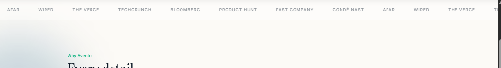

# ✈️ Advenza

> **Plan beyond the map.** 
> An AI travel companion that designs trips as thoughtfully as you would, with real budgets, gentle pacing, and the quiet corners guidebooks miss.



## 🌟 Key Features

* **AI Trip Commander**: Generates multi-day plans that pace your energy, not just fill your calendar.
* **What-If Simulator (Decision Engine)**: Swap a museum for a hike or move a night. The entire plan re-optimizes instantly.
* **AI Risk Radar**: Real-time safety signals—weather, crowds, transport delays—monitored 24/7.
* **Real Budgets & Price Watch**: Live cost tracking with alerts before you overspend. Tracks flights and stays to ping you the moment prices drop.
* **Group Planning & Consensus**: Vote on stops, split expenses, and keep everyone in the loop without the arguments.
* **Memory Timeline**: Instagram integration to turn your trip photos into a beautiful, shareable timeline.

## 🛠️ Tech Stack

This project is built using a modern, ultra-fast frontend stack:

* **Framework**: React 19 + TanStack Start (SSR)
* **Routing**: TanStack Router (File-based routing)
* **Build Tool**: Vite
* **Styling**: Tailwind CSS v4
* **Animations**: Framer Motion (Hardware Accelerated at 120 FPS)
* **UI Components**: Radix UI (Headless primitives)
* **Icons**: Lucide React

## 🚀 Getting Started

### Prerequisites
Make sure you have [Node.js](https://nodejs.org/) (v20+) and [npm](https://www.npmjs.com/) installed on your machine.

### Installation

1. Clone the repository:
```bash
git clone https://github.com/134shubhamyadav/Aventra.git
```

2. Navigate into the project directory:
```bash
cd Aventra
```

3. Install dependencies:
```bash
npm install
```

4. Start the development server:
```bash
npm run dev
```

5. Open your browser and visit: `http://localhost:3000`

## 👥 Team Workflow (How to Contribute)

We use a **Feature Branch Workflow** to ensure code stability on the `main` branch. 

1. **Always pull the latest code first:**
   ```bash
   git checkout main
   git pull origin main
   ```
2. **Switch to your personal/feature branch:** (e.g., `shubham`, `jihaan`, `luckshith`, `yaksh`)
   ```bash
   git checkout your-branch-name
   git merge main
   ```
3. **Write your code, commit, and push!**
   ```bash
   git add .
   git commit -m "Brief description of what you built"
   git push origin your-branch-name
   ```
4. **Merge to Main:** Go to GitHub and open a **Pull Request (PR)** to merge your branch into `main`.

---
*Made with care in Bengaluru, Mumbai & Jaipur.*
