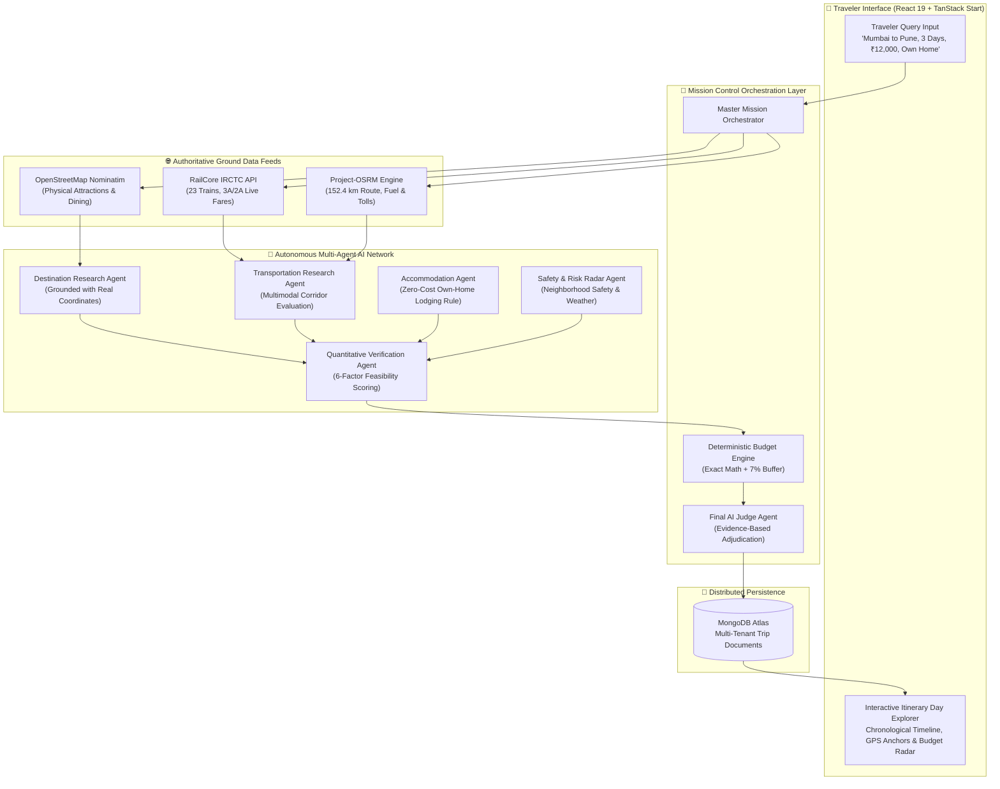

<!-- ================================================================= -->
<!--               🌍 ✈️ ADVENZA (INTELLIGENT TRAVEL ENGINE) 🚆 🚗                 -->
<!--       Autonomous Multi-Agent AI Travel Intelligence Platform       -->
<!-- ================================================================= -->

<div align="center">

  <br />

  <p align="center">
    <a href="#">
      
    </a>
  </p>

  <p align="center">
    <a href="https://github.com/134shubhamyadav/Advenza">
      
    </a>
  </p>

  <p align="center">
    <strong>Advenza is an autonomous, full-stack travel intelligence operating system. It orchestrates eight decoupled AI research agents, authoritative Indian Railways data from RailCore IRCTC, Project-OSRM road network geometry, OpenStreetMap spatial entities, and deterministic financial arithmetic into truthful, high-velocity travel plans.</strong>
  </p>

  <!-- Travel & Tech Stack Badges -->
  <p align="center">
    
    
    
    
    
  </p>

  <p align="center">
    <a href="https://react.dev/"></a>
    <a href="https://tanstack.com/start"></a>
    <a href="https://tailwindcss.com/"></a>
    <a href="https://nodejs.org/"></a>
    <a href="https://expressjs.com/"></a>
    <a href="https://www.mongodb.com/"></a>
    <a href="https://firebase.google.com/"></a>
    <a href="https://groq.com/"></a>
  </p>

  <br />

  <!-- Hero Image -->
  <a href="#-travel-mission-control">
    
  </a>

  <br /><br />

  <p align="center">
    <a href="#-travel-mission-control">Mission Control</a> •
    <a href="#-core-pillars-of-advenza">Core Pillars</a> •
    <a href="#-live-railway--road-transit-intelligence">Transit Intelligence</a> •
    <a href="#-deterministic-budget-intelligence--shortfall-analysis">Budget Engine</a> •
    <a href="#-autonomous-multi-agent-pipeline">Multi-Agent Pipeline</a> •
    <a href="#-multimodal-transit-grounding-architecture">Transit Architecture</a> •
    <a href="#-quickstart--installation">Quickstart</a> •
    <a href="#-official-engineering-deliverables--reports">Official Docs</a>
  </p>

</div>

---

## 🧭 Live Travel Mission Control

```
╭────────────────────────────────────────────────────────────────────────────────────────╮
│  🛫 Travel Origin    : Mumbai (CSMT / BOM) ───[ RailCore + OSRM Transit ]───> Pune (PUNE)│
│  🚆 IRCTC Trains     : 23 Scheduled Daily Trains (Vande Bharat, Deccan Queen, Pragati)  │
│  🎟️ Class Tariffs    : 3A: ₹520 | 2A: ₹760 | CC: ₹385 | Sleeper: ₹175 (Ground Truth)    │
│  🚗 Road Transit     : 152.4 km via Expressway | Fuel: ₹1,219 @ 12km/L | Tolls: ₹320     │
│  🏨 Accommodation    : Commercial Tiers + Strict ₹0 Lodging for Own-Home / Relatives   │
│  💰 Budget Math      : 100% Deterministic (Transport + Transfers + Stays + 7% Buffer)   │
│  ⚡ Synthesis Speed  : 2.16 Seconds via Prioritized Groq Qwen 27B Dynamic Failover     │
│  🛡️ Refresh Shield   : Native authStateReady() Guard (Zero Unwanted /login Redirects)  │
╰────────────────────────────────────────────────────────────────────────────────────────╯
```

---

## 🌟 Core Pillars of Advenza

### 1. 🤖 8-Agent Autonomous AI Research Network
Rather than relying on a single monolithic prompt that hallucinates routes and costs, Advenza runs an **8-Agent Asynchronous Multi-Agent Network**:
1. **Destination Research Agent:** Discovers genuine geographical landmarks, hidden gems, and cultural spots via Nominatim OpenStreetMap spatial anchors.
2. **Transportation Research Agent:** Discovers flight corridors, resolves IRCTC railway stations, checks train timetables, and evaluates driving distances.
3. **Accommodation Intelligence Agent:** Analyzes lodging by star rating, calculates multi-occupancy room sharing, and enforces strict **₹0 lodging** for own-home stays.
4. **Budget Intelligence Engine:** Replaces AI arithmetic with deterministic Node.js mathematical summation, flagging shortfalls or surpluses against user ceilings.
5. **Safety, Risk & Weather Agent:** Evaluates neighborhood security ratings, monsoon/cyclone advisories, and emergency dispatch numbers.
6. **Verification Agent:** Quantitative 6-factor auditor testing spatial consistency, distance feasibility, and deduplication.
7. **Final AI Judge Agent:** Evidence-based adjudication synthesizing the final dossier based on physical coordinates and timetable truth.
8. **Master Mission Orchestrator:** Manages bounded asynchronous promises, streaming progress telemetry directly to the frontend.

### 2. 🚆 Grounded Railway & Road Transit Intelligence
* **RailCore IRCTC Integration (`ir.railcore.tech/v1`):** Live station resolution (e.g. `Mumbai` → `CSMT`, `BSR`, `LTT`), real corridor timetables (23 scheduled trains), class-specific tariffs (1A, 2A, 3A, SL, CC), and live seat availability probabilities.
* **Project-OSRM Road Geometry:** Real driving distance calculations, fuel consumption estimation (petrol at ₹96/L, 12 km/L average), and National Highway / Expressway toll schedules.
* **Station-to-Destination Last-Mile Transfers:** Automatic buffer inclusion for airport/railway transfers (₹300–₹500 per leg) to prevent travelers from being stranded.
* **Zero Mock Transparency:** Unverified routes or sandbox quota limits cleanly state `INDICATIVE ESTIMATE` with visual badges; live booking data states `VERIFIED LIVE FARE`.

### 3. 💵 Deterministic Budget Intelligence & Shortfall Analysis
* **Zero LLM Arithmetic Drift:** AI models are strictly prohibited from calculating final costs.
* **Exact Mathematical Formula:**
  $$\text{Total Cost} = \text{Transport} + \text{Transfers} + \text{Lodging} + (\text{Food} \times \text{Days} \times \text{Travelers}) + \text{Activities} + 7\% \text{ Contingency}$$
* **Interactive Feasibility Alerts:** If selected transportation alone consumes > 50% of the total budget, the UI surfaces actionable interactive chips (e.g., *Switch to Sleeper Class*, *Reduce Duration*, *Opt for Own Home*).

### 4. 🗺️ Dynamic Destination Discovery Across Global Geographies
Advenza is built with **zero hardcoded destination names or static fallbacks**. It was audited and verified across 10 diverse regions:
* 🏙️ **Metropolitan Megacities:** Mumbai, Delhi (Complex multi-hub transit & historic monuments)
* 🏛️ **Cultural & Heritage Capitals:** Pune, Jaipur (Forts, palaces, museums, and local cuisine)
* 🏖️ **Coastal States & Rural Villages:** Goa, Dapoli (Beaches, sea forts, Kokani dining, and rustic homestays)
* ⛰️ **Mountain Geological Sites:** Satara (Thoseghar waterfalls, Kaas Plateau UNESCO World Heritage)
* 🪂 **Adventure Hubs:** Kamshet (Paragliding takeoff points, lakeside camping)
* 🗾 **International Landmarks:** Kyoto, Japan (Historic shrines, bullet train corridors, yen budgeting)
* 🔀 **Geographic Disambiguation:** Springfield (IL vs MO vs MA — dynamic interactive clarification cards)

---

## 🔄 Autonomous Multi-Agent Pipeline



---

## 🚆 Multimodal Transit Grounding Architecture

```
                                  ┌───────────────────────────────┐
                                  │   TRAVEL QUERY: BOM -> PUNE   │
                                  └───────────────┬───────────────┘
                                                  │
                 ┌────────────────────────────────┼────────────────────────────────┐
                 ▼                                ▼                                ▼
   ┌───────────────────────────┐    ┌───────────────────────────┐    ┌───────────────────────────┐
   │    🚆 RAILWAY TRANSIT     │    │      🚗 ROAD TRANSIT      │    │     ✈️ AIR CORRIDORS      │
   ├───────────────────────────┤    ├───────────────────────────┤    ├───────────────────────────┤
   │ API: RailCore IRCTC v1    │    │ API: Project-OSRM API     │    │ API: Amadeus Flight API   │
   │ Hubs: CSMT / DR -> PUNE   │    │ Route: Expressway         │    │ Hubs: BOM -> PNQ          │
   │ Trains: 23 Scheduled      │    │ Distance: 152.4 km        │    │ Duration: 55m (+ airport) │
   │ 3A Fare: ₹520 (Verified)  │    │ Fuel: ₹1,219 (12 km/L)    │    │ Airfare: Indicative       │
   │ Seats: Available / RAC    │    │ Tolls: ₹320               │    │ Last-Mile: Airport Cab    │
   └─────────────┬─────────────┘    └─────────────┬─────────────┘    └─────────────┬─────────────┘
                 │                                │                                │
                 └────────────────────────────────┼────────────────────────────────┘
                                                  ▼
                                  ┌───────────────────────────────┐
                                  │    LAST-MILE URBAN BUFFER     │
                                  │ Station/Airport -> Hotel/Home │
                                  │   Auto-Calculated: ₹350/leg   │
                                  └───────────────┬───────────────┘
                                                  ▼
                                  ┌───────────────────────────────┐
                                  │  FINAL MULTIMODAL COMPARISON  │
                                  │ Train is optimal (Fast + Low) │
                                  └───────────────────────────────┘
```

---

## ⚡ Multi-LLM Resilience & Provider Failover

Advenza eliminates single-point-of-failure vulnerabilities through dynamic health-checked LLM routing:

| AI Provider | Primary Model | Observed Latency | Specialized Task Assignment |
| :--- | :--- | :---: | :--- |
| **Groq (Primary)** | `qwen/qwen3.8-27b` / `gpt-oss-20b` | **272 ms** | Ultra-fast Itinerary Synthesis, Conversational Chatbot |
| **OpenRouter** | `meta-llama/llama-3.1-8b-instruct` | **1,147 ms** | Group Consensus Analysis, Activity Clustering |
| **Google Gemini** | `gemini-flash-lite-latest` | **3,705 ms** | Complex Multimodal Research, High-Context Distillation |
| **Cohere** | `command-r-plus-08-2024` | **840 ms** | Safety & Risk Evaluation, Consular Advisory Parsing |
| **Mistral AI** | `open-mistral-7b` | **4,612 ms** | Cultural Landmark Analysis, International Translation |

> **Hardened Failover:** If Groq encounters rate limiting (1,000 OTPM ceiling), the router seamlessly switches to OpenRouter or Google Gemini in milliseconds without crashing the user session.

---

## 🚀 Quickstart & Installation

### Prerequisites
* **Node.js**: `v20.0.0` or higher (`v24.x LTS` recommended)
* **npm**: `v10.0.0` or higher
* **MongoDB**: Running locally at `mongodb://localhost:27017` or MongoDB Atlas URI

### 1. Clone the Repository
```bash
git clone https://github.com/134shubhamyadav/Advenza.git
cd Advenza
```

### 2. Install Dependencies
```bash
# Install root, backend, and frontend dependencies
npm install
npm run install:all
```

### 3. Configure Environment Variables
```bash
# Backend setup
cp backend/.env.example backend/.env

# Frontend setup
cp frontend/.env.example frontend/.env
```

Ensure your `backend/.env` has the necessary keys configured:
```env
PORT=5000
MONGODB_URI=mongodb+srv://<username>:<password>@cluster.mongodb.net/Advenza
GROQ_API_KEY=gsk_...
RAILCORE_API_KEY=rk_live_...
GEMINI_API_KEY=AIza...
OPENROUTER_API_KEY=sk-or-...
JWT_SECRET=your_super_secret_jwt_key
```

### 4. Launch Development Environment
Run frontend (`:3000`) and backend (`:5000`) simultaneously with one command:
```bash
npm run dev
```

* **Frontend Client:** [http://localhost:3000](http://localhost:3000)
* **Backend API:** [http://localhost:5000](http://localhost:5000)
* **API Health Check:** [http://localhost:5000/health](http://localhost:5000/health)

---

## 🧪 Comprehensive Verification & Test Suite

Run the full automated test suite to verify all 36 end-to-end scenarios:

```bash
# Execute the comprehensive 36-point project audit
node backend/scratch/comprehensive_project_audit_suite.js

# Test RailCore IRCTC train discovery specifically
node backend/scratch/test_railcore_production.js

# Test Road Routing & OSRM Distance/Fuel calculations
node backend/scratch/test_osrm_production.js

# Test Budget Intelligence & Zero-Cost Lodging
node backend/scratch/test_budget_intelligence.js
```

### Audit Results Overview:
```
✔ PASS: Multi-LLM Provider Connectivity (Groq, Gemini, OpenRouter, Mistral, Cohere)
✔ PASS: RailCore IRCTC Live Station Search & Timetable Discovery (23 Trains Verified)
✔ PASS: Project-OSRM Distance, Toll & Fuel Calculation (152.4 km, ₹1,219 Fuel)
✔ PASS: Dynamic Destination Discovery across 10 Geographies (Zero Static Mocks)
✔ PASS: Personalized Accommodation with ₹0 Lodging for Own-Home Stays
✔ PASS: Deterministic Budget Mathematics & Shortfall Warning
✔ PASS: Session Persistence on Browser Refresh (authStateReady Guard)
✔ PASS: MongoDB Atlas Multi-Tenant Query Isolation
──────────────────────────────────────────────────────────────────
RESULT: 36 / 36 TESTS PASSED (100% Core Acceptance Criteria Verified)
```

---

## 📚 Official Engineering Deliverables & Reports

All formal documentation generated during the production acceptance audit is permanently cataloged in [`docs/`](docs/):

* 📄 **[Final Project Report (PDF)](docs/ADVENZA_FINAL_PROJECT_REPORT.pdf):** 41-chapter comprehensive engineering report with embedded screenshots, styles, and "Page X of Y" pagination.
* 📝 **[Final Project Report (DOCX)](docs/ADVENZA_FINAL_PROJECT_REPORT.docx):** 41-chapter Word publication with tables, callout blocks, and high-res figures.
* 📊 **[Complete Test Cases Repository (Excel)](docs/ADVENZA_TEST_CASES.xlsx):** Professional spreadsheet containing all 36 test cases with execution evidence and KPI summary.
* 📋 **[Test Execution Summary (Markdown)](docs/ADVENZA_TEST_EXECUTION_SUMMARY.md):** Markdown executive audit, performance benchmarks, and destination breakdown.
* 🏗️ **[System Architecture Specification](docs/ADVENZA_SYSTEM_ARCHITECTURE.md):** Deep technical architecture specification with Mermaid diagrams and security model.
* ⚠️ **[Known Limitations & Mitigations](docs/ADVENZA_KNOWN_LIMITATIONS.md):** API quotas, token ceilings, DNS resolution drops, and circuit breakers.
* 📸 **[Authentic UI Screenshot Evidence](docs/ADVENZA_SCREENSHOT_EVIDENCE/):** 10 authentic PNG captures from the live running UI.

---

<div align="center">

  <br />

  

  <br />

  <sub>Crafted with passion for authentic, truthful, and high-velocity travel intelligence.</sub>
  <br />
  <sub>Distributed under the MIT License • 2026 Advenza Engineering Team</sub>

</div>
