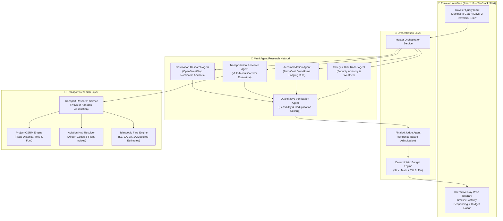

<!-- ================================================================= -->
<!--               🌍 ✈️ ADVENZA (TRIP COMMANDER) 🚆 🚗                 -->
<!--       Autonomous Multi-Agent AI Travel Intelligence Platform       -->
<!-- ================================================================= -->

<div align="center">

  <br />

  <p align="center">
    <a href="#">
      
    </a>
  </p>

  <p align="center">
    <a href="https://github.com/134shubhamyadav/Advenza">
      
    </a>
  </p>

  <p align="center">
    <strong>Advenza is an autonomous, full-stack AI travel planning and destination intelligence platform.</strong><br />
    Synthesizing multi-modal transit corridors, OpenStreetMap physical grounding, and deterministic budget mathematics into truth-certified, day-wise itineraries.
  </p>

  <p align="center">
    
    
    
    
  </p>

</div>

---

## 🧭 V1 Product Definition & Scope

Advenza V1 is an **AI-powered travel planning and destination intelligence platform**. It focuses on research, discovery, day-wise planning, multi-modal transport cost intelligence, and budget calculation.

### What V1 Delivers:
1. **AI-Powered Travel Planning:** End-to-end trip creation guided by conversational intelligence and interactive preference elicitation.
2. **Destination Research & Discovery:** Authentic points of interest, cultural landmarks, restaurants, food specialties, and verified hidden gems grounded via OpenStreetMap Nominatim.
3. **Day-Wise Itinerary Generation:** Chronological daily schedules with realistic activity durations, travel times, and meal sequencing.
4. **Multi-Modal Transport Research & Cost Intelligence:** Provider-agnostic evaluation of Trains, Flights, Buses, Road Trips (Drive), and Local Transit with durations, fare ranges, and transparent price classifications.
5. **Deterministic Budget Intelligence:** Strict Node.js arithmetic for lodging, dining, activities, transport, and a 7% contingency reserve—with zero LLM arithmetic drift.
6. **Smart Packing & Checklist Generation:** Context-aware, weather-informed packing checklists tailored to destination and trip duration.
7. **Trip Management & Dashboard:** Saved trips, customizable day schedules, notes, and collaborative trip twin sharing.
8. **Conversational Travel Assistant:** Context-aware travel copilot supporting natural language modifications to itineraries, budgets, and recommendations.

### V1 Architectural Boundaries:
* **No Bookings or Payments:** Advenza is a travel intelligence and planning platform, not a ticketing agent or payment processor. It does not conduct financial transactions, seat reservations, or ticket purchases.
* **Memories Feature Removed:** The legacy media memories, social reels, and photo collages features have been cleanly excised from the active application to optimize performance and focus on travel intelligence.
* **Custom Railway Database Deferred:** The internal custom SQLite database infrastructure (`railways.db`, `railways_v2.db`, sync scrapers) is safely deferred to future releases. The physical database files are preserved in isolation on disk. Active V1 uses the lightweight, provider-agnostic **Transport Research Abstraction**.

---

## 🌟 Core Pillars of Advenza V1

### 1. 🤖 Autonomous Multi-Agent AI Research Network
Rather than relying on a single monolithic prompt that hallucinates routes, costs, and attractions, Advenza deploys a coordinated multi-agent orchestration pipeline:
1. **Destination Research Agent:** Discovers genuine geographical landmarks, cultural heritage sites, and dining specialties via OpenStreetMap spatial anchors.
2. **Transportation Research Agent:** Evaluates multi-modal corridors (Trains, Flights, Buses, Road Trips), resolves major transit hubs, and estimates journey durations and fares.
3. **Accommodation Intelligence Agent:** Analyzes lodging by star rating, calculates multi-occupancy room sharing, and enforces strict **₹0 lodging** for own-home stays.
4. **Budget Intelligence Engine:** Replaces AI arithmetic with deterministic Node.js mathematical summation, flagging shortfalls or surpluses against user ceilings.
5. **Safety, Risk & Weather Agent:** Evaluates neighborhood security ratings, monsoon/cyclone advisories, and emergency dispatch numbers.
6. **Verification Agent:** Quantitative 6-factor auditor testing spatial consistency, distance feasibility, and deduplication.
7. **Final AI Judge Agent:** Evidence-based adjudication synthesizing the final dossier based on physical coordinates and timetable truth.
8. **Master Mission Orchestrator:** Manages bounded asynchronous promises, streaming progress telemetry directly to the frontend.

### 2. 🚆 Grounded Multi-Modal Transport Research
Advenza V1 features a lightweight, provider-agnostic **Transport Research Service** (`backend/services/travel/transport-research.service.js`) providing balanced comparisons across 5 modes:
* **Train Journeys:** Modelled against the official Indian Railways telescopic fare formula (SL, 3A, 2A, 1A, CC) and major railhead gateway hubs, computing realistic journey duration and fare ranges without locking SQLite databases.
* **Flights:** Evaluates flight corridors via IATA airport resolver (e.g., BOM, DEL, BLR, GOI, GOX) and aviation indices, providing flight travel time and indicative airfare ranges.
* **Buses:** Intercity road transit analysis (Volvo, AC Sleeper, State Transport) for regional routes under 1,000 km, factoring in highway speeds and typical fares.
* **Road Trips (Drive):** Live Project-OSRM highway geometry calculations, turn-by-turn road distance, realistic fuel consumption (14 km/L at ₹102/L), and national highway FASTag toll estimates.
* **Local Transit:** Intra-city transit allowances (metro, app cabs, auto rickshaws) tailored to destination tier and group size.

### 3. 🏷️ Explicit Price Classification System
To ensure total honesty and transparency with travelers, every transport and budget figure is classified into one of three strict tiers:
* `actual published price`: Verified from an authoritative operational schedule or live published tariff.
* `retrieved estimate`: Retrieved from an external API or live routing service (e.g. Project-OSRM highway distance).
* `modelled estimate`: Derived from verified mathematical models, official distance formulas (e.g. Indian Railways telescopic fare tables), or historical benchmarks.

If pricing or schedule data cannot be verified, Advenza preserves the unavailable state rather than fabricating numbers.

### 4. 💵 Deterministic Budget Intelligence
* **Zero LLM Arithmetic Drift:** AI models are strictly prohibited from calculating final costs.
* **Exact Mathematical Formula:**
  $$\text{Total Cost} = \text{Transport} + \text{Transfers} + \text{Lodging} + (\text{Food} \times \text{Days} \times \text{Travelers}) + \text{Activities} + 7\% \text{ Contingency Buffer}$$
* **Zero-Cost Lodging Constraint:** Staying at one's own home, native residence, or with relatives deterministically charges ₹0 for lodging, reserving the traveler's budget for transit, food, and activities.
* **Feasibility Alerts:** If selected transportation alone consumes > 50% of the budget ceiling, the system flags the shortfall with actionable suggestions (e.g., switch to train sleeper class, adjust trip duration).

### 5. 🗺️ Dynamic Destination Discovery Across Global Geographies
Advenza is built with **zero hardcoded destination names or static fallbacks**. It dynamically researches any valid global or domestic destination:
* 🏙️ **Metropolitan Hubs:** Mumbai, Delhi, Bengaluru, Chennai (Multi-terminal transit, urban metro, heritage landmarks)
* 🏖️ **Coastal & Leisure Destinations:** Goa, Kochi, Pondicherry (Beaches, maritime heritage, coastal cuisine)
* ⛰️ **Hill Stations & Retreats:** Manali, Ooty, Shimla, Darjeeling (Gateway transit transfers, scenic viewpoints, mountain weather)
* 🏛️ **Cultural & Spiritual Centers:** Varanasi, Jaipur, Udaipur, Ayodhya (Historic ghats, palaces, local food trails)
* 🔀 **Geographical Disambiguation:** Resolves ambiguous place names (e.g., Springfield IL vs MO) using interactive disambiguation cards.

---

## 🔄 Autonomous Multi-Agent Pipeline



---

## ⚡ Multi-LLM Resilience & Provider Failover

Advenza includes a resilient AI routing system with automatic multi-tier fallback across major inference providers:

```
[Tier 1: Groq (Llama-3.3-70b / Llama-3.1-8b)]
       │
       ▼ (Fallback on Rate Limit / 429)
[Tier 2: NVIDIA NIM (Llama-3.1-70b-instruct / Mistral-Large)]
       │
       ▼ (Fallback on 5xx / Timeout)
[Tier 3: OpenAI (GPT-4o-mini / GPT-4o)]
       │
       ▼ (Fallback on Outage)
[Tier 4: Gemini API (Gemini-2.0-Flash / Gemini-1.5-Pro)]
       │
       ▼ (Fallback on Exhaustion)
[Tier 5: Together AI / OpenRouter / Mistral / Cerebras]
```

---

## ⚙️ V1 Environment Variables Specification

Advenza requires the following environment variables. Set them in `backend/.env` and `frontend/.env`:

### Backend Configuration (`backend/.env`)

| Variable | Requirement | Description |
| :--- | :--- | :--- |
| `PORT` | Optional (default: `5000`) | Backend HTTP port |
| `NODE_ENV` | Optional (default: `development`) | Environment (`development` or `production`) |
| `MONGODB_URI` | **Required** | MongoDB connection string (Atlas or local) |
| `JWT_SECRET` | **Required** | Secret key for local JWT authentication tokens |
| `MEDIA_SECRET` | Optional | HMAC secret for signed expense receipt URLs |
| `GROQ_API_KEY` | Recommended | Primary high-speed LLM provider for agent orchestration |
| `OPENAI_API_KEY` | Optional | Secondary LLM provider fallback (GPT-4o / GPT-4o-mini) |
| `GEMINI_API_KEY` | Optional | Google Gemini inference fallback |
| `NVIDIA_API_KEY` | Optional | NVIDIA NIM inference provider |
| `MISTRAL_API_KEY` | Optional | Mistral AI inference provider |
| `OPENROUTER_API_KEY` | Optional | OpenRouter universal inference aggregator |
| `TOGETHER_API_KEY` | Optional | Together AI inference provider |
| `CEREBRAS_API_KEY` | Optional | Cerebras ultra-fast Llama inference provider |
| `COHERE_API_KEY` | Optional | Cohere Command-R inference provider |
| `FIREBASE_PROJECT_ID` | Optional | Firebase Auth project ID for token verification |
| `FIREBASE_SERVICE_ACCOUNT_JSON` | Optional | Firebase Admin SDK credentials JSON string |
| `BREVO_API_KEY` | Optional | Brevo / Sendinblue SMTP API key for invitations |
| `AMADEUS_CLIENT_ID` | Optional | Amadeus GDS API client ID for flight lookups |
| `AMADEUS_CLIENT_SECRET` | Optional | Amadeus GDS API client secret |
| `GOOGLE_MAPS_API_KEY` | Optional | Google Maps Directions API key |
| `SKIP_RAILWAY_SYNC` | Optional (default: `true`) | Defer background SQLite railway synchronization in V1 |

### Frontend Configuration (`frontend/.env`)

| Variable | Requirement | Description |
| :--- | :--- | :--- |
| `VITE_API_URL` | Optional (default: `http://localhost:5000`) | Backend API base URL |
| `VITE_FIREBASE_API_KEY` | Optional | Firebase Client API key |
| `VITE_FIREBASE_AUTH_DOMAIN` | Optional | Firebase Auth domain |
| `VITE_FIREBASE_PROJECT_ID` | Optional | Firebase Project ID |

---

## 🚀 Quickstart & Installation

### Prerequisites
* **Node.js:** v20.x or higher (v24.x recommended)
* **npm:** v10.x or higher
* **MongoDB:** Local instance or free MongoDB Atlas cluster

### 1. Clone the Repository
```bash
git clone https://github.com/134shubhamyadav/Advenza.git
cd Advenza
```

### 2. Install Dependencies
```bash
# Install root, backend, and frontend packages
npm install
npm install --prefix backend
npm install --prefix frontend
```

### 3. Configure Environment Variables
```bash
# Backend setup
cp backend/.env.example backend/.env
# Edit backend/.env and provide at least MONGODB_URI and one AI API key (e.g. GROQ_API_KEY)
```

### 4. Launch Development Environment
```bash
# Starts both frontend (http://localhost:3000) and backend (http://localhost:5000) concurrently
npm run dev
```

### 5. Build for Production
```bash
npm run build
```

---

## 🧪 Verification & Acceptance Testing

Execute the comprehensive automated V1 acceptance test suite to verify authentication, trip persistence, itinerary generation, budget mathematics, and multi-modal transport research:

```bash
# Execute the automated V1 acceptance suite
node backend/test_v1_acceptance.js
```

### Key Acceptance Criteria Verified:
* ✔ **Clean Builds:** Frontend and backend compile without syntax or bundle errors.
* ✔ **Authentication & Security:** JWT and Firebase token verification with route protection.
* ✔ **Trip Creation & Persistence:** Seamless database creation and multi-tenant isolation.
* ✔ **Day-Wise Itinerary Generation:** Chronological activity sequencing and realistic timing.
* ✔ **Multi-Modal Transport Research:** Trains (telescopic formula), Flights, Buses, and Drive (OSRM).
* ✔ **Explicit Price Classification:** Transparent `modelled estimate` and `retrieved estimate` labels.
* ✔ **Deterministic Budget Mathematics:** Exact lodging, transport, meal, activity, and buffer summation.
* ✔ **Zero-Cost Lodging Constraint:** ₹0 lodging for own-home and relative stays.
* ✔ **Memories Removal Verified:** `/memory` UI routes and `/api/memories` endpoints return 404.
* ✔ **Railway Databases Untouched:** All physical railway database files preserved intact on disk.

---

<div align="center">

  <br />

  

  <br />

  <sub>Crafted with passion for authentic, truthful, and high-velocity travel intelligence.</sub><br />
  <sub>Distributed under the MIT License • Advenza Engineering Team</sub>

</div>
